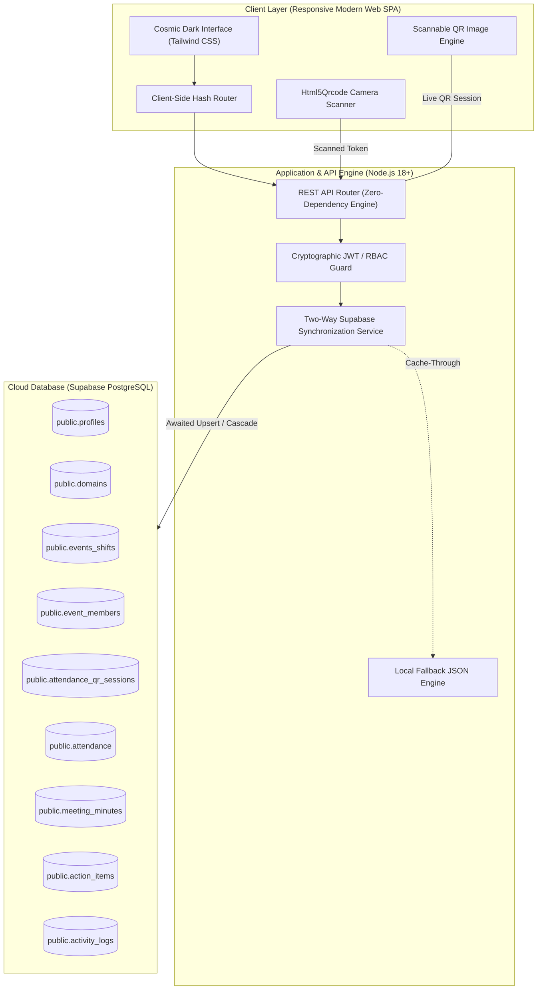

<div align="center">

  

  # 🏛️ CABSSA Clubdesk
  ### Unified Executive Workspace & Internal Operations Management System
  **Computer Science & Business Systems Association (CABSSA)**

  <p align="center">
    A high-concurrency, database-driven association management platform built to centralize committee workflows, real-time member records, dynamic reverse QR attendance, minutes of meetings (MoM), duty delegations, and sprint action items.
  </p>

  <p align="center">
    <a href="https://cabssa-clubdesk.vercel.app" target="_blank">
      
    </a>
  </p>

  <p align="center">
    
    
    
    
    
    
    
  </p>

  ---

  ### 🌐 **[Explore Live Production Web Application ↗](https://cabssa-clubdesk.vercel.app)**

</div>

---

## 📑 Table of Contents

- [Overview & Executive Summary](#-overview--executive-summary)
- [System Architecture](#-system-architecture)
- [Core Feature Modules](#-core-feature-modules)
  - [1. Role-Based Access Control (RBAC)](#1-role-based-access-control-rbac)
  - [2. Member Directory & Dossiers](#2-member-directory--dossiers)
  - [3. 8 Association Domains](#3-8-association-domains)
  - [4. Dynamic Reverse QR Attendance Engine](#4-dynamic-reverse-qr-attendance-engine)
  - [5. Event & Shift Management](#5-event--shift-management)
  - [6. Minutes of Meeting (MoM) Archive](#6-minutes-of-meeting-mom-archive)
  - [7. Action Items & Sprint Task Board](#7-action-items--sprint-task-board)
  - [8. Analytics & Appreciation Certificates](#8-analytics--appreciation-certificates)
  - [9. Immutable Audit Trail & Health Diagnostics](#9-immutable-audit-trail--health-diagnostics)
  - [10. Database Backup & Disaster Recovery](#10-database-backup--disaster-recovery)
- [Database Architecture (Supabase PostgreSQL)](#-database-architecture-supabase-postgresql)
- [REST API Specification](#-rest-api-specification)
- [Directory Structure](#-directory-structure)
- [Local Development & Quickstart](#-local-development--quickstart)
- [Production Deployment](#-production-deployment)
- [Pre-Configured Administrative Access](#-pre-configured-administrative-access)
- [Engineering Principles](#-engineering-principles)
- [License & Association Leadership](#-license--association-leadership)

---

## 💡 Overview & Executive Summary

The **Computer Science & Business Systems Association (CABSSA)** operates across multiple academic domains, coordinating dozens of student organizers, recurring technical workshops, hackathons, and administrative sessions. Historically, committee data was fragmented across disparate Google Sheets, WhatsApp groups, and unverified paper logs.

**CABSSA Clubdesk** was engineered to solve this operational friction by establishing a single, immutable, and high-concurrency source of truth. Built strictly to the **14-section PRD v1.0 specifications**, the system delivers:
- **Zero Configuration Friction**: Runs on zero external npm dependencies with native Node.js core modules.
- **Enterprise-Grade Relational Persistence**: Backed by a cloud-hosted Supabase PostgreSQL instance with foreign keys, cascades, and ACID transactions.
- **Fraud-Resistant Attendance Tracking**: Proprietary **Reverse QR** architecture where hosts broadcast dynamic, time-limited cryptographic tokens scanned by member devices with sub-second duplicate rejection.
- **Mission Control UI**: Modern, glassmorphic Cosmic Dark Navy aesthetic optimized for mobile viewports, tablets, and high-resolution desktop displays.

---

## 🏗️ System Architecture

CABSSA Clubdesk adopts a decoupled, event-driven client-server architecture deployed on **Vercel Edge Infrastructure** and backed by **Supabase PostgreSQL Cloud**.



---

## ✨ Core Feature Modules

### 1. Role-Based Access Control (RBAC)
- **Three-Tier Security Clearance**:
  - `ADMIN` (Faculty Advisors, Association President, General Secretary): Unrestricted CRUD permissions across all tables, CSV imports, member deactivations, system diagnostics, and audit log access.
  - `CO_HEAD` (Domain Leads & Event Heads): Can schedule events, assign shift duties, record meeting minutes, assign tasks, and broadcast attendance QR codes.
  - `CORE_MEMBER` (Organizing Committee Members): Read access to rosters, task progress updates, and live camera QR check-in capabilities.
- **Multi-Credential Sign-In**: Authenticate seamlessly using either **Institutional Email** or **College PRN Number**.
- **Dual Storage Persistence**: Login credentials securely stored in both `localStorage` and `sessionStorage` to survive page refreshes and mobile browser tabs.

### 2. Member Directory & Dossiers
- Comprehensive member profiles featuring:
  - Unique **Member ID** (`CABSSA-2026-XXX`), **College PRN Number**, and **Class Roll Number**.
  - **Academic Standing**: Academic Year (`FY`, `SY`, `TY`, `Final Year`) and Division (`A`, `B`, `C`, `D`).
  - **Domain Assignment**: Linked directly to one of the 8 association domains.
  - **Emergency & Logistics Metadata**: Contact number, Date of Birth, Date of Joining, and **Personal Vehicle Availability** (crucial for ground logistics during college events).
- **Graceful Deactivation**: Soft-delete preserves historical attendance, shift duties, and completed tasks while revoking system privileges.
- **Bulk CSV Data Interchange**: 1-click export of the entire roster to CSV and high-speed CSV batch import with automated validation.

### 3. 8 Association Domains
Dedicated workspaces tailored to each division's operational scope:
1. **Technical**: Web architecture, software systems, and hackathon infrastructure.
2. **Design & Graphics**: Posters, UI/UX, branding kits, and digital collateral.
3. **Registration**: Delegate desks, ticket verifications, and participant communications.
4. **Finance & Sponsorship**: Corporate funding, budget ledgers, and vendor disbursements.
5. **Film & Media**: Photography, video coverage, reels, and after-movies.
6. **Logistics**: Venue booking, sound/AV systems, transport, and equipment inventory.
7. **Documentation**: Official college letters, administrative proposals, and permissions.
8. **Content Creation**: Social media copywriting, speeches, and formal announcements.

### 4. Dynamic Reverse QR Attendance Engine
- **Host-Broadcast Model**: Eliminates queues at registration desks. The Admin or Event Coordinator displays a dynamic QR code on a projector, laptop, or mobile screen.
- **Time-Limited Cryptographic Sessions**: Each QR session generates a unique cryptographic token (`CABSSA-ATT-[timestamp]-[salt]`) with an active 30-minute countdown timer.
- **Auto-Provisioning Session Fallback**: If no specific event is selected, the engine auto-creates a **"Daily Club Session"** on the fly, enabling instant 1-click attendance broadcasting.
- **In-Browser Camera Scanner**: Integrated `Html5Qrcode` mobile camera viewfinder automatically detects, decodes, and submits the attendance token.
- **Anti-Duplicate Fraud Protection**: Unique composite database constraint `(event_id, member_id)` guarantees zero duplicate check-ins; second attempts are immediately rejected with exact timestamps.
- **Manual Token Input**: Provides a 1-click "Copy Token" button for members experiencing camera or hardware limitations.

### 5. Event & Shift Management
- Comprehensive event creation: Title, Description, Date, Shift Start/End times, Campus Location, and Domain association.
- **Shift Duty Delegation**: Assign individual committee members specific operational responsibilities (e.g., "Main Stage AV Control", "Guest Hospitality Desk").
- Live event status tracking (`Upcoming`, `Ongoing`, `Completed`, `Cancelled`).

### 6. Minutes of Meeting (MoM) Archive
- Permanent, searchable institutional memory of all association meetings.
- Captures Meeting Title, Date, Agenda, In-Depth Discussion Points, Action Decisions, and Tagged Attendee Rosters.
- Real-time client-side search across past minutes by title, agenda keyword, or decision note.

### 7. Action Items & Sprint Task Board
- Sprint task board with priority badges: `Urgent` (Rose), `High` (Amber), `Medium` (Indigo), and `Low` (Slate).
- Direct member assignment with strict due dates.
- Interactive status progression: `Open` ➔ `In Progress` ➔ `Completed`.
- Personal filter toggle: View "My Assigned Tasks Only" for focused execution.

### 8. Analytics & Appreciation Certificates
- High-level metric KPI cards: Total Members, Active Shifts, Verified Attendance Count, and Task Completion Percentages.
- Attendance frequency distribution and domain participation breakdowns.
- **Instant Certificate Generator**: Generates clean, printable **Certificate of Appreciation** directly in the browser with verified dates, member names, designations, and association signatures.

### 9. Immutable Audit Trail & Health Diagnostics
- Comprehensive security audit log records every administrative action (timestamp, user, action type, entity ID, client IP).
- Built-in diagnostic endpoint (`/api/health`) reporting system uptime, memory allocation, and active PostgreSQL connection status.

### 10. Database Backup & Disaster Recovery
- 1-click administrative backup button generates a complete, timestamped JSON snapshot of all 9 database tables for cold storage or disaster recovery.

---

## 🗄️ Database Architecture (Supabase PostgreSQL)

The backend is backed by a fully normalized PostgreSQL 15 schema hosted on Supabase Cloud:

| Table Name | Primary Key | Description | Key Foreign Keys & Constraints |
| :--- | :--- | :--- | :--- |
| `domains` | `id (UUID)` | 8 core association branches | Unique `code`, unique `name` |
| `profiles` | `id (UUID)` | Committee members & admins | Unique `email`, unique `prn_number`, unique `member_id`, references `domains(id)` |
| `events_shifts` | `id (UUID)` | Association events & meetings | References `domains(id)`, `profiles(id)` |
| `event_members` | `id (UUID)` | Event duty assignments | References `events_shifts(id)`, `profiles(id)` |
| `attendance_qr_sessions` | `id (UUID)` | Active dynamic QR sessions | Unique `session_token`, references `events_shifts(id)` |
| `attendance` | `id (UUID)` | Verified attendance check-ins | Unique composite `(event_id, member_id)`, references `events_shifts(id)`, `profiles(id)` |
| `meeting_minutes` | `id (UUID)` | Executive meeting archives | References `profiles(id)` (created_by) |
| `action_items` | `id (UUID)` | Delegated committee tasks | References `profiles(id)` (assigned_to, created_by) |
| `activity_logs` | `id (UUID)` | System administrative audit log | References `profiles(id)` (actor_id) |

---

## 🔌 REST API Specification

| Endpoint | Method | Access Level | Description |
| :--- | :--- | :--- | :--- |
| `/api/health` | `GET` | Public | System health, uptime, and database diagnostics |
| `/api/auth/setup-status` | `GET` | Public | Informs client whether initial Super Admin exists |
| `/api/auth/setup-admin` | `POST` | Public (Initial) | Bootstraps the first Administrator account |
| `/api/auth/login` | `POST` | Public | Authenticates via Email or PRN; returns signed JWT |
| `/api/auth/me` | `GET` | Authenticated | Retrieves current authenticated member profile |
| `/api/domains` | `GET` | Public | Lists all 8 domains with enriched member counts |
| `/api/members` | `GET` | Authenticated | Filters/searches members by domain, status, or query |
| `/api/members` | `POST` | `ADMIN` only | Creates a new permanent committee member |
| `/api/members/:id` | `PUT` | `ADMIN` only | Updates an existing member profile |
| `/api/members/:id` | `DELETE` | `ADMIN` only | Deactivates or permanently deletes a member |
| `/api/members/import-csv` | `POST` | `ADMIN` only | Bulk imports member records from parsed CSV text |
| `/api/events` | `GET` | Authenticated | Lists all scheduled events and duty rosters |
| `/api/events` | `POST` | `ADMIN` / `CO_HEAD` | Creates a new association event |
| `/api/events/:id/duties` | `POST` | `ADMIN` / `CO_HEAD` | Assigns an operational duty to a member |
| `/api/attendance` | `GET` | Authenticated | Fetches attendance logs (filterable by event or member) |
| `/api/attendance/qr/create` | `POST` | `ADMIN` / `CO_HEAD` | Generates a 30-min reverse QR attendance session |
| `/api/attendance/qr/scan` | `POST` | Authenticated | Validates token, rejects duplicates, records check-in |
| `/api/meetings` | `GET` / `POST` | Authenticated | Queries or archives Minutes of Meeting (MoM) |
| `/api/tasks` | `GET` / `POST` | Authenticated | Fetches or creates sprint action items |
| `/api/tasks/:id` | `PUT` | Authenticated | Updates task progression status |
| `/api/activity-logs` | `GET` | `ADMIN` only | Retrieves chronological audit logs |
| `/api/backup/export` | `GET` | `ADMIN` only | Downloads complete database JSON snapshot |

---

## 📂 Directory Structure

```text
CABSSA-ClubDesk/
├── api/
│   ├── _server.js             # High-concurrency Node.js REST router & Supabase sync engine
│   ├── index.js               # Vercel Serverless Function entrypoint
│   └── [...path].js           # Vercel catch-all serverless dispatcher
├── data/
│   ├── clubdesk.json          # Atomic fallback database seed
│   └── clubdesk.backup.json   # Secondary disaster recovery mirror
├── js/
│   ├── config.js              # Client configuration & Supabase cloud endpoints
│   ├── api.js                 # Unified HTTP API client & dual-storage session manager
│   ├── auth.js                # Role-Based Access Control (RBAC) & login engine
│   ├── app.js                 # SPA Router, toast notifications, and application bootstrap
│   └── modules/
│       ├── activity.js        # Administrative audit log viewer
│       ├── attendance.js      # Reverse QR generation & Html5Qrcode live camera decoder
│       ├── dashboard.js       # Executive KPI metrics and domain breakdown charts
│       ├── domains.js         # 8 Departmental domain directory
│       ├── events.js          # Event scheduling, calendar, and duty allocations
│       ├── meetings.js        # Minutes of Meeting (MoM) records & attendee tags
│       ├── members.js         # Member roster CRUD, modal drawers, and CSV import/export
│       ├── reports.js         # Statistical analytics and Appreciation Certificate engine
│       ├── settings.js        # Diagnostics and 1-click JSON database backup
│       └── tasks.js           # Action Items & Kanban sprint board
├── lib/
│   └── embedded-assets.js     # Auto-generated embedded asset bundle for serverless deployment
├── public/                    # Production static edge assets mirrored for Vercel CDN
│   ├── index.html
│   ├── logo.png
│   └── js/
├── scripts/
│   └── generate-assets.js     # Build script to embed assets and synchronize public/
├── supabase/
│   └── setup.sql              # Complete PostgreSQL schema, foreign keys, and seed migration
├── tests/
│   └── setup.test.js          # Automated validation test suite
├── index.html                 # Production SPA HTML layout (Tailwind Cosmic Dark theme)
├── logo.png                   # Official CABSSA Association insignia
├── package.json               # Project manifest, engine specifications, and scripts
├── vercel.json                # Vercel Serverless v2 deployment manifest
├── CONTRIBUTING.md            # Guidelines for team contributors
├── LICENSE                    # MIT License
└── README.md                  # Comprehensive project documentation
```

---

## 💻 Local Development & Quickstart

### Prerequisites
- Node.js 18.0.0 or higher
- Git

### 1. Clone the Repository
```bash
git clone https://github.com/mrdineshausaramal-maker/CABSSA-ClubDesk.git
cd CABSSA-ClubDesk
```

### 2. Start the Server
No `npm install` needed! The application uses standard Node.js native core modules:
```bash
node server.js
```

### 3. Open in Browser
Navigate to **`http://localhost:3000`** in your browser.

---

## 🚀 Production Deployment

The project is pre-configured for automated continuous deployment on **Vercel**:

1. **Connect GitHub Repository**: Link this repository in your Vercel Dashboard.
2. **Environment Variables** (Optional, falls back to pre-configured production defaults):
   - `SUPABASE_URL`: Your Supabase Project URL (`https://your-id.supabase.co`)
   - `SUPABASE_ANON_KEY`: Your Supabase Public Anon Key
   - `JWT_SECRET`: Secret key used for signing session tokens
3. **Deploy**: Every push to the `main` branch triggers an automated build and edge deployment.

---

## 🔑 Pre-Configured Administrative Access

For testing and evaluation on the live deployment:

| Attribute | Credential Detail |
| :--- | :--- |
| **Email Address** | `mr.dineshausaramal@gmail.com` |
| **Alternative PRN** | `2526UCB026` |
| **Default Password** | `Cabssa@2026` |
| **Assigned Role** | `ADMIN` (Full System Clearance) |

---

## ⚙️ Engineering Principles

1. **Zero Runtime Dependencies**: The entire full-stack server runs with native Node.js APIs (`http`, `crypto`, `fs`, `path`). Eliminates `node_modules` bloat, supply chain attack vectors, and cold-start latency.
2. **Deterministic Data Integrity**: Supabase PostgreSQL enforces strict relational integrity with foreign keys, uniqueness constraints, and automated timestamps.
3. **Optimistic & Resilient UI**: Immediate visual feedback, asynchronous promise handling, and clear error boundaries prevent blank screens or frozen UI states.
4. **Accessible & Responsive**: Fully responsive design tested across desktop monitors, iPads/tablets, and mobile viewports.

---

## 📄 License & Association Leadership

This project is open-source software licensed under the **[MIT License](LICENSE)**.

**Developed with ❤️ for the Computer Science & Business Systems Association (CABSSA)**  
Lead Developer & System Architect: **Dinesh Ausaramal**  
*Department of Computer Science & Business Systems (CSBS)*
